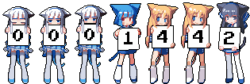

  

  

  
  
   
  
  

You can call me **RYÚK** or **GOPU** or **Rathijitk**
 I'm a new independent developer,

Modding and patching.. web developer `</>`
 Still learning (ʘᴗʘ✿)...!

- I love listening to music 🎧
- I care about Dark 🌑
- I have a wave about development web pages `</>` and apps
- (✿^‿^) ❤ with passion ..

<picture>
  <source media="(prefers-color-scheme: dark)" srcset="https://raw.githubusercontent.com/rathijitk404/rathijitk404/output/github-snake-dark.svg" />
  <source media="(prefers-color-scheme: light)" srcset="https://raw.githubusercontent.com/rathijitk404/rathijitk404/output/github-snake.svg" />
  
</picture>

<table>
  <tr>
    <td align="center" width="98">
      
       HTML
    </td>
    <td align="center" width="98">
      
       CSS
    </td>
    <td align="center" width="98">
      
       JavaScript
    </td>
    <td align="center" width="98">
      
       Android
    </td>
    <td align="center" width="98">
      
       Git
    </td>
  </tr>
</table>

<table>
  <tr>
    <td align="center" width="50%">
      
    </td>
    <td align="center" width="50%">
      
    </td>
  </tr>
</table>

<table>
  <tr>
    <td align="center" width="50%">
      
    </td>
    <td align="center" width="50%">
      
    </td>
  </tr>
</table>

  
   
  

  

