  

# RYÚK ZÉRÖ

## Hi there 👋

You can call me **RYÚK** or **GOPU** or **Rathijitk**
 I'm a new independent developer,

### What I do...

Modding and patching.. web developer `</>`
 Still learning (ʘᴗʘ✿)...!

## NEW DEVELOPER ( ꈍᴗꈍ)

<picture>
  <source media="(prefers-color-scheme: dark)" srcset="https://raw.githubusercontent.com/rathijitk404/rathijitk404/output/github-snake-dark.svg" />
  <source media="(prefers-color-scheme: light)" srcset="https://raw.githubusercontent.com/rathijitk404/rathijitk404/output/github-snake.svg" />
  
</picture>

---

## Profile Views

  

---

  
  
  
  

---
